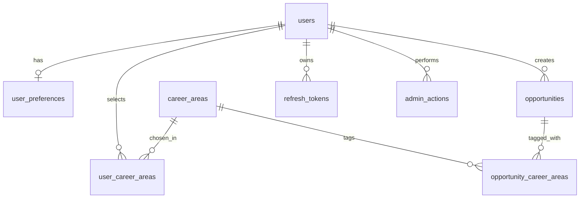

# Database Schema

PostgreSQL 15 or newer, accessed through Sequelize. All changes go through migrations in `src/migrations/`. Columns are `snake_case`. Sequelize models use `underscored: true`, so the application sees camelCase attributes (`careerAreaId`, `createdAt`) that map to columns (`career_area_id`, `created_at`), and the API returns camelCase. Migrations, raw SQL, `CHECK` constraints and expression indexes always use the column names. The Data Analysts' CSV headers also use column names, and the importer maps them to attributes. The data dictionary lists the CSV header, API key and field side by side.

## Relationships

## Enums (shared contract)

The vocabulary lives in `src/config/taxonomy.json`, documented in [`data-dictionary.md`](data-dictionary.md) and owned by Data Analysts and Product. Changing a list needs agreement from the owner in the last column. In the database these columns are `VARCHAR` with a `CHECK` constraint, rather than native Postgres enum types, because removing or renaming a value in a native enum is painful (ADR-013). The constraint values are copied into each migration, so a merged migration never changes meaning, and a test compares `taxonomy.json` with the migrated database. The table below repeats the lists for convenience, and the taxonomy wins if they ever differ.

| Enum | Values | Owner |
|---|---|---|
| `role` | `student`, `admin` (`provider` added later) | Backend |
| `education_level` | `secondary_school`, `undergraduate`, `fresh_graduate` (to confirm) | Data Analysts, Product |
| `type` | `workshop`, `internship`, `bootcamp`, `seminar`, `training`, `scholarship` (to confirm) | Data Analysts |
| `delivery_format` | `remote`, `onsite`, `hybrid` | Data Analysts |
| `cost_type` | `free`, `paid`, `scholarship_available` | Data Analysts |
| `skill_level` | `beginner`, `intermediate`, `advanced`, `all_levels` | Data Analysts |
| `verification_status` | `unverified`, `verified`, `rejected` (review state only, expiry is derived from `deadline`) | Product, Data Analysts, Backend |
| `account_status` | `active`, `disabled` (a temporary login lock is derived from `locked_until`, not a status) | Backend, Cybersecurity |

## users

| Column | Type | Constraints and notes |
|---|---|---|
| `id` | UUID | PK, default `gen_random_uuid()` |
| `full_name` | VARCHAR(100) | NOT NULL |
| `email` | VARCHAR(254) | NOT NULL, UNIQUE, stored lowercase |
| `password_hash` | VARCHAR(255) | NOT NULL, Argon2id encoded string |
| `role` | VARCHAR | NOT NULL, default `student` |
| `education_level` | VARCHAR | nullable, filled in during onboarding, not at registration |
| `institution` | VARCHAR(150) | nullable |
| `field_of_study` | VARCHAR(150) | nullable |
| `reset_token_hash` | VARCHAR(255) | nullable, hash only |
| `reset_token_expires_at` | TIMESTAMPTZ | nullable |
| `account_status` | VARCHAR | NOT NULL, default `active` |
| `failed_login_attempts` | INTEGER | NOT NULL, default 0 |
| `locked_until` | TIMESTAMPTZ | nullable |
| `created_at`, `updated_at` | TIMESTAMPTZ | NOT NULL |

Index: unique on `email`. The password hash is excluded from every default query through a Sequelize default scope.

## career_areas

| Column | Type | Constraints |
|---|---|---|
| `id` | INTEGER | PK, identity |
| `name` | VARCHAR(100) | NOT NULL, UNIQUE |
| `slug` | VARCHAR(100) | NOT NULL, UNIQUE |

The Data Analysts own the final list. Seeded from `seeders/`.

## user_career_areas

`user_id` (FK users, ON DELETE CASCADE) and `career_area_id` (FK career_areas, ON DELETE RESTRICT). Composite PK on both. Extra index on `career_area_id`.

## user_preferences

| Column | Type | Notes |
|---|---|---|
| `user_id` | UUID | PK and FK to users, ON DELETE CASCADE |
| `preferred_types` | TEXT[] | NOT NULL, default `{}`, each value validated in the app against `type` |
| `preferred_formats` | TEXT[] | NOT NULL, default `{}` |
| `free_only` | BOOLEAN | NOT NULL, default false |
| `created_at`, `updated_at` | TIMESTAMPTZ | |

Arrays are `TEXT[]` rather than arrays of a Postgres enum type, which Sequelize handles poorly. Validation sits in the Zod schema. This is an intentionally weaker database guarantee than the `CHECK` constraints on opportunities: a script, a manual change or a bug that bypasses validation could store an invalid value. Join tables or array-aware constraints would close that gap, and for the MVP they are not worth the extra work.

## opportunities

| Column | Type | Constraints and notes |
|---|---|---|
| `id` | UUID | PK |
| `title` | VARCHAR(200) | NOT NULL |
| `provider_name` | VARCHAR(150) | NOT NULL, plain text in the MVP |
| `description` | TEXT | NOT NULL |
| `type` | VARCHAR | NOT NULL, CHECK against enum |
| `delivery_format` | VARCHAR | NOT NULL, CHECK |
| `cost_type` | VARCHAR | NOT NULL, CHECK |
| `cost_amount` | NUMERIC(12,2) | nullable |
| `currency` | CHAR(3) | nullable, no default, required whenever `cost_amount` is set |
| `skill_level` | VARCHAR | NOT NULL, default `all_levels` |
| `location` | VARCHAR(150) | nullable |
| `duration_weeks` | INTEGER | nullable, CHECK > 0 |
| `start_date` | DATE | nullable |
| `deadline` | DATE | nullable |
| `eligible_education_levels` | TEXT[] | NOT NULL, default `{}`, empty means open to all |
| `application_url` | TEXT | NOT NULL, https only |
| `source_url` | TEXT | NOT NULL, https only |
| `verification_status` | VARCHAR | NOT NULL, default `unverified` |
| `reviewed_by` | UUID | nullable, FK users, ON DELETE RESTRICT. The admin who made the latest review decision, whether verified or rejected |
| `reviewed_at` | TIMESTAMPTZ | nullable. When that decision was made |
| `last_checked_at` | TIMESTAMPTZ | nullable |
| `is_featured` | BOOLEAN | NOT NULL, default false |
| `created_by` | UUID | NOT NULL, FK users, ON DELETE RESTRICT |
| `updated_by` | UUID | nullable, FK users, ON DELETE RESTRICT |
| `deleted_at` | TIMESTAMPTZ | nullable, set on archive |
| `created_at`, `updated_at` | TIMESTAMPTZ | |

CHECK constraints (business rule BD-007, to confirm): `cost_type <> 'free' OR (cost_amount IS NULL AND currency IS NULL)`; `cost_type <> 'paid' OR (cost_amount > 0 AND currency IS NOT NULL)`; `cost_amount IS NULL OR currency IS NOT NULL`. A candidate to confirm with the Data Analysts: `deadline IS NULL OR start_date IS NULL OR deadline <= start_date`, which some programmes break by accepting applications after they start. An empty `deadline` means no closing date, not expired.

Indexes: `type`, `delivery_format`, `cost_type`, `deadline`, `verification_status`, `source_url` (not unique, since some providers reuse one page for several opportunities), and a partial index on `deadline WHERE deleted_at IS NULL` for the catalogue query. The index does not mention a verification status, so changing the publication rule never needs a new index.

Duplicates are detected, not forbidden. A likely duplicate is an active opportunity with the same `lower(title)`, `lower(provider_name)` and `start_date` (empty dates compare as equal), or with the same `source_url`. A plain expression index on `(lower(title), lower(provider_name))` keeps the lookup fast. It is created with `queryInterface.sequelize.query` inside a migration, because Sequelize cannot declare expression indexes in a model. The database does not reject these rows. The admin create endpoint and the CSV importer find likely duplicates and ask an admin to decide, because two real opportunities can share a title, provider and start date but differ in cohort, location or link. If Product and Data later confirm that those fields define identity, this can become a unique index.

### Publication rule

Which opportunities students can see is business rule BD-001: approved for publication and not expired. The model defines it once, as a Sequelize scope named `publishable`. Its current definition is `verification_status = 'verified'`, `deleted_at IS NULL`, and a `deadline` that is empty or not before today, where today is the calendar date in Africa/Lagos. A deadline of 2026-11-01 stays valid through 2026-11-01 in Lagos. Compute today with `(now() AT TIME ZONE 'Africa/Lagos')::date` or the equivalent in code, and never compare a UTC `new Date()` directly against the `DATE` column. Every student-facing query uses the scope, and no route, service or raw query repeats the condition. If Product changes the rule, only the scope changes. The admin queue uses an unscoped query instead.

## opportunity_career_areas

`opportunity_id` (FK opportunities, ON DELETE CASCADE) and `career_area_id` (FK career_areas, ON DELETE RESTRICT). Composite PK. Extra index on `career_area_id`.

## admin_actions

| Column | Type | Notes |
|---|---|---|
| `id` | UUID | PK |
| `admin_id` | UUID | NOT NULL, FK users, ON DELETE RESTRICT |
| `action` | VARCHAR | `create`, `update`, `review`, `archive` |
| `target_type` | VARCHAR | `opportunity` for now |
| `target_id` | UUID | NOT NULL |
| `changes` | JSONB | nullable. The fields that changed, as `{ "verificationStatus": { "from": "unverified", "to": "verified" } }`. Never a full record snapshot, and never personal data or secrets. A create made with `confirmNotDuplicate` also records `{ "duplicateOverride": true, "matchedIds": [...] }` |
| `created_at` | TIMESTAMPTZ | NOT NULL |

Append only. The application never updates or deletes rows here. Index on `(target_type, target_id)` and on `admin_id`.

## refresh_tokens

| Column | Type | Notes |
|---|---|---|
| `id` | UUID | PK |
| `user_id` | UUID | NOT NULL, FK users, ON DELETE CASCADE |
| `token_hash` | VARCHAR(64) | NOT NULL, UNIQUE, SHA-256 of the token |
| `expires_at` | TIMESTAMPTZ | NOT NULL |
| `revoked_at` | TIMESTAMPTZ | nullable |
| `created_at` | TIMESTAMPTZ | NOT NULL |

Refresh tokens are long random strings, so a fast SHA-256 hash is enough here. Bcrypt is for low-entropy passwords. Index on `user_id`. A scheduled clean-up of expired rows can wait until after the MVP.

## Deletion and audit

Students and their personal data can be deleted. `DELETE /me` removes the user row, and `user_preferences`, `user_career_areas` and `refresh_tokens` go with it through `ON DELETE CASCADE`. Nothing audit-related points at a student, because only admins create, review or change opportunities.

Admin accounts are never hard-deleted. `created_by`, `updated_by`, `reviewed_by` and `admin_actions.admin_id` all use `ON DELETE RESTRICT`, so the database refuses to delete a user that history points at. To remove an admin's access, set `account_status` to `disabled`. If an admin's personal details ever have to be erased, the row is anonymised (name and email replaced) and kept, and that decision belongs to Cybersecurity and Product. `DELETE /me` is refused for admins.

## Migration rules

1. One migration per logical change, named with a timestamp and a verb (`create-opportunities`, `add-locked-until-to-users`).
2. Every migration has a working `down`.
3. Never edit a merged migration. Add a new one.
4. Run `db:migrate` in CI against an empty database to prove the chain works from scratch.
5. Migrations run as a pipeline step before the new app version starts, never at app boot.
6. Vocabulary `CHECK` constraints are written with the values copied into the migration at that moment, never read from `taxonomy.json`. A new value means a new migration.

## Seeding

`seeders/career-areas` loads the career areas from `taxonomy.json`. `npm run seed:opportunities -- path/to/file.csv --admin <email>` imports the Data Analysts' dataset. `created_by` is the admin named by `--admin`, who must exist and be active, so every imported row is attributed to a real person. If imports later run from the deployment pipeline, a dedicated import admin account can be used instead. Likely duplicates (see Indexes) are written to the import report and skipped unless the command is run with `--allow-duplicates`. CSV headers follow the template in `data-dictionary.md`, which uses the column names above (excluding system columns). Rows with an invalid enum value or a non-https URL are rejected and written to a report file, not silently skipped. Imported rows start as `unverified`.